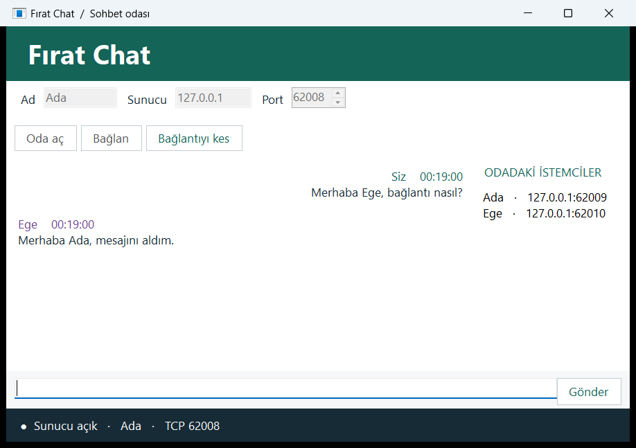
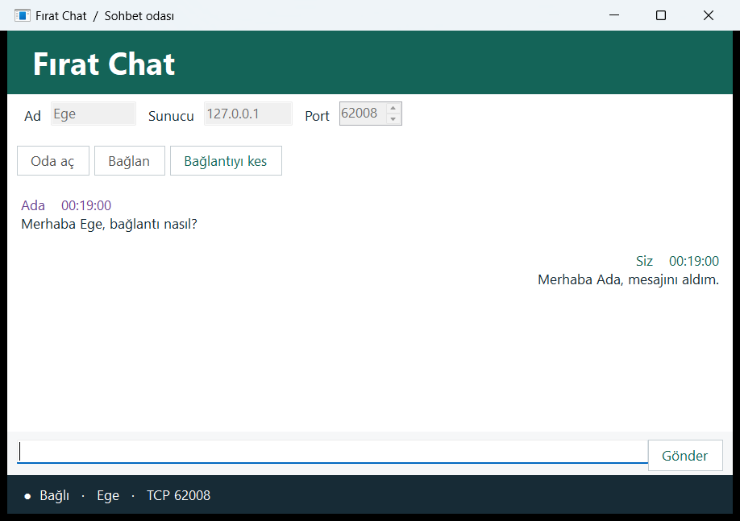

# Fırat Chat

Aynı bilgisayarda veya yerel ağda adla katılınabilen TCP sohbet odası.

**YMH219 Nesne Tabanlı Programlama** · Muhammed AHMED · 250541604

## Kullanılan teknolojiler

C#, .NET 10 ve Windows Forms. TcpListener, TcpClient, StreamReader/StreamWriter, System.Text.Json ve async/await. Haricî paket gerekmez.

## Kurulum ve çalıştırma

Windows 10/11 x64 üzerinde Git ve .NET 10 SDK gerekir. SDK kurulumunu `dotnet --list-sdks` ile kontrol edebilirsiniz. [Microsoft .NET 10 indirmeleri](https://dotnet.microsoft.com/download/dotnet/10.0)

```powershell
git clone https://github.com/MuhammedAHMED7/YMH219-ChatApp.git
cd YMH219-ChatApp
dotnet restore
dotnet build -c Release
dotnet run -c Release --no-build
```

Visual Studio'da .NET 10 destekli bir sürüm ve **.NET masaüstü geliştirme** iş yüküyle `ChatApp.csproj` dosyasını açıp F5'e basabilirsiniz.

## Temel özellikler ve kullanım

1. Birinci pencerede adınızı girip **Oda aç** düğmesine basın. Bu pencere hem sunucuyu çalıştırır hem de sohbete katılır.
2. İkinci bir uygulama örneği açın. Farklı bir ad, aynı port ve sunucunun adresini girip **Bağlan** düğmesine basın. Aynı bilgisayarda `127.0.0.1` kullanın. Yerel ağda sunucunun yerel IP adresini girin.
3. Metni yazıp **Gönder** veya Enter’a basın. Kendi iletileriniz “Siz”, diğerleri gönderenin adı ve farklı renkle görünür. İstemci adları ve bağlantı uçları sunucuda listelenir.
4. **Bağlantıyı kes** ile ayrılıp tekrar katılabilirsiniz. Sunucu penceresinde bağlantıyı kesmek odayı kapatır.

Kendi mesajlarınız sağa, karşı tarafınkiler sola hizalanır. Katılımcı paneli sunucu penceresinde görünür. Bir mesaj gönderilirken yazılan yeni taslak korunur.

## Sınıflar ve sorumluluklar

`ChatServer` bağlantıları kabul eder ve mesajları diğer istemcilere iletir. `Peer` satır tabanlı JSON paketlerini okur ve eşzamanlı yazmaları sıralar. `ChatClient` katılım, gönderme ve bağlantının kapanmasını yönetir. `MainForm` ağ olaylarını Windows arayüz iş parçacığına aktarır.

## Ekran görüntüleri





## Test ve bilinen sınırlamalar

İki pencere arasında iki yönde mesaj, sunucuda katılımcı sayısı, ayrılma ve yeniden bağlandıktan sonra mesaj gönderme doğrulandı. Sunucu kapanışı ve kapalı porta bağlanma hata bildirimi sınandı. Deneme aynı cihazda yapıldı. Protokol şifreleme veya kullanıcı kimlik doğrulaması sağlamaz. Ders gösterimi için aynı bilgisayarda ya da güvenilen yerel ağda kullanılır.
